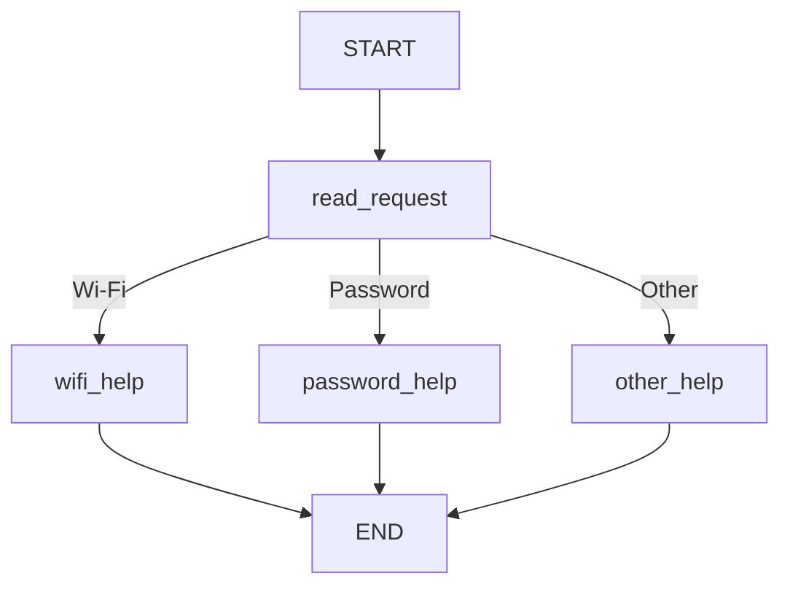
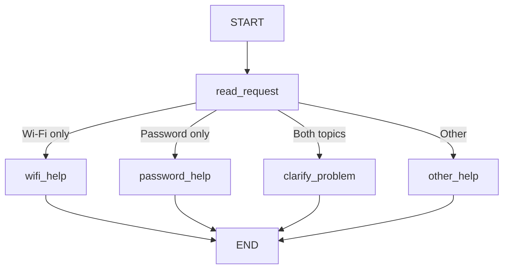
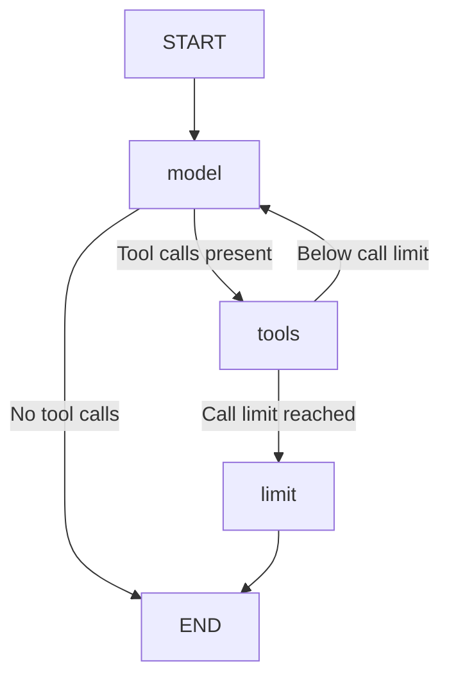

# HW5 — My LangGraph helpdesk

## Part 1 — How the graph works

### My graph and state

## Part 1 — How the graph works

### My graph and state

The state contains three fields:

| Field | Meaning |
| --- | --- |
| message | The original user message |
| category | The category selected by read_request |
| reply | The answer from a help node |

The nodes read and update these fields:

| Node | Reads | Updates |
| --- | --- | --- |
| read_request | message | category |
| wifi_help | category and the Wi-Fi guide in data/helpdesk.json | reply |
| password_help | category and the password guide in data/helpdesk.json | reply |
| other_help | category | reply |

The original message stays in the state.

#### 1. What does each node read and change?

read_request reads the message and sets the category.
The help nodes set the reply.
The Wi-Fi and password nodes use instructions from data/helpdesk.json.
other_help asks whether the problem is about Wi-Fi or a password.

#### 2. State update versus conditional edge

A node returns an update to the state, for example a category.
The conditional edge reads the category and selects the next node.
Changing the state and choosing the next node are separate actions.

#### 3. What does the next node receive?

The next node receives the current graph state.
It does not receive only the previous node's update.
For example, the original message is still available after the category is set.

#### 4. START, END and compilation

START is the entry point of the graph.
END marks the end of a graph run.
Compiling builds an executable graph from its nodes and edges.
Compilation does not run a user request.

### Predictions before running
These predictions were written before running the program.
The actual routes will be recorded after execution.

| Message | Predicted route | Actual route | What I learned |
| --- | --- | --- | --- |
| I cannot connect to Wi-Fi. | START → read_request → wifi_help → END | START → read_request → wifi_help → END | The Wi-Fi keyword selects wifi_help. |
| I forgot my PASSWORD. | START → read_request → password_help → END | START → read_request → password_help → END | Uppercase letters do not affect routing because the message is converted to lowercase. |
| My laptop screen is broken. | START → read_request → other_help → END | START → read_request → other_help → END | An unsupported topic leads to a question about Wi-Fi or passwords. |
| My Wi-Fi password does not work. | START → read_request → wifi_help → END | START → read_request → wifi_help → END | The Wi-Fi rule is checked first, so it takes priority when both topics appear. |

For the fourth message, I predict wifi_help because the Wi-Fi rule is checked first.
The password rule is checked only if the Wi-Fi rule does not match.

### My change to the graph

The changed graph includes a separate clarification node:

I added a check for both topics before the individual topic checks.

Actual S05 trace:

1. read_request received "My Wi-Fi password does not work."
   It changed category from "" to "both".
   The original message stayed unchanged, and reply was still empty.
2. clarify_problem set reply to:
   "Which problem would you like to solve first: connecting to Wi-Fi or recovering your account password?"

Actual route: START → read_request → clarify_problem → END.

The full trace is saved in outputs/S05_part1.json.

Before the change, S04 selected wifi_help because the Wi-Fi rule was checked first.
After the change, S05 selected clarify_problem because both topics were detected.
The execution path changed, not only the final answer.

LangGraph manages state updates and execution through the graph's nodes and edges.
My Python functions define the keyword checks, select the category,
choose the next node and create the reply.
No language model is used in Part 1.

## Part 2 — Model and tools

### Model and provider

Provider: OpenAI.
Configured model: gpt-4.1-mini.
The actual runs reported gpt-4.1-mini-2025-04-14.

### Model and tool loop

### 1. How does the graph choose tools or a final answer?

after_model checks the latest AI message.
If tool_calls is not empty, the graph runs the tools node.
Otherwise, the graph ends with the model's answer.

### 2. Who requests and executes tools?

The model requests a tool by returning its name and arguments.
The Python run_tools function executes the requested tool.
The tool result is returned to the model as a ToolMessage.

### 3. What changes in the state?

The messages list stores user messages, model replies,
tool requests and tool results.
New messages are appended using the add reducer.
model_calls counts model calls for the current user turn.
limit_reached records whether the tool loop limit was reached.

### 4. How is this different from Part 1?

Part 1 uses fixed Python keyword rules.
Part 2 lets the model select tools and arguments.
The model receives tool results before deciding its next action.

### Direct tool calls

I called all three tools without a model using:

python demo_tools.py

The log is outputs/direct_tools_demo.json.
The tools returned instructions, selected service-status snapshots
and a local ticket draft.

### Actual model runs

| Profile | Log | Observed result |
| --- | --- | --- |
| normal | outputs/part2_normal.json | Retrieved GUIDE-WIFI, checked operational status, then prepared a local draft. |
| wifi_outage | outputs/part2_outage.json | Checked Wi-Fi status and did not prepare the conditional draft. |
| status_unavailable | outputs/part2_unknown.json | Received unknown status and asked whether to prepare a draft mentioning uncertainty. |
| normal, missing details | outputs/part2_missing.json | Asked for details first, then checked status and prepared a draft after the user supplied them. |
| recovery_outage | outputs/part2_recovery.json | Checked account_recovery, received outage and did not prepare the conditional draft. |

The normal run used find_instructions in the first turn.
In the second turn, it used check_service_status followed by
prepare_ticket. The draft included GUIDE-WIFI as a reference.
Nothing was sent to a real helpdesk.

### Loop limit

MAX_MODEL_CALLS is 6 per user turn.
After tool execution, after_tools checks the model call count.
At the limit, the graph runs the limit node instead of calling
the model again. This node sets limit_reached to true and ends.
A recursion_limit of 30 provides an additional graph execution limit.

None of the demonstrated runs reached the loop limit.

### Problems found during demonstrations

The initial normal run inferred an extra reconnecting step.
I strengthened the prompt to use only explicitly reported actions.

The initial outage response incorrectly suggested that drafting
was impossible during an outage. I clarified that the draft was
not created because of the user's condition and repeated the run.

The unknown-status response asked again for details already supplied.
I added an instruction to check existing messages before asking.

I also removed offers of automatic monitoring, because the program
does not implement background status checks.

These prompt changes do not guarantee perfect model behaviour.
Further checks are needed to verify them.

## Part 3 — Memory

### Conversation memory

I use LangGraph SqliteSaver to save conversation state in
local-storage/conversations.sqlite.

The state contains previous user messages, model replies and tool results.
The checkpointer restores these messages after a process restart.
The application sends only the new user message when continuing a thread.

### User memory

I store language preferences separately in local-storage/users.sqlite.
The remember_language tool saves a preference explicitly requested
by the user. Preferences are loaded using the application's user identifier.
They are not hard-coded or loaded from demo_users.json.

### User identifier and thread_id

The user identifier selects a user's saved preference.
The thread identifier selects a conversation.

The checkpoint key combines the user identifier and thread identifier.
This separates conversations between users and between threads.
A new thread starts without the previous thread's messages,
but the same user's language preference remains available.

### Retrieval versus memory

find_instructions retrieves reference information from data/helpdesk.json.
These instructions are supplied knowledge, not a remembered conversation.

The language preference is memory because it was learned from a user
message and saved for later use.

### Observed memory checks

| Situation | Command used | Log file | What happened |
| --- | --- | --- | --- |
| Save preference and problem | python part3.py --user demo-user-a --thread restart-a --profile normal --log S11_before_restart_2.json | outputs/S11_before_restart_2.json | remember_language saved Kazakh. The conversation recorded the Wi-Fi problem and reported steps. |
| Close, restart and resume | python part3.py --user demo-user-a --thread restart-a --profile normal --log S11_after_restart_2.json | outputs/S11_after_restart_2.json | Restored 6 previous messages and the Kazakh preference. Recalled enabling Wi-Fi and trying to reconnect. |
| Same user, new conversation | python part3.py --user demo-user-a --thread preference-check-new --profile normal --log preference_new_thread.json | outputs/preference_new_thread.json | Previous message count was 0, but the saved language was Kazakh. |
| Different user | python part3.py --user demo-user-b --thread isolation-check-new --profile normal --log isolation_new_user.json | outputs/isolation_new_user.json | Previous message count was 0 and saved language was null. No information from user A appeared. |

These are development checks. The complete supplied scenario sequences
with their required resets must still be run separately.

## Part 4 — Running and checking my work

TODO: point to the README setup steps, package versions, memory-reset instructions, tests and GitHub Actions workflow. Explain which mistake each test catches and which runs use a fake model.

## Choices and limitations

TODO: explain the storage and libraries I chose, why they fit this task, and what still does not work reliably.

## Supplied scenarios — my actual results

| Scenario | Command or manual steps | Log file | What happened / what I changed |
| --- | --- | --- | --- |
| S01 — Simple Wi-Fi route | python part1.py | outputs/S01_part1.json | Selected wifi_help and returned GUIDE-WIFI. |
| S02 — Case-insensitive password route | python part1.py | outputs/S02_part1.json | Selected password_help despite uppercase PASSWORD. |
| S03 — Unsupported request | python part1.py | outputs/S03_part1.json | Selected other_help and asked which supported topic applies. |
| S04 — Two topics before the graph change | python part1.py | outputs/S04_part1.json | Selected wifi_help because the Wi-Fi rule had priority. |
| S05 — Two topics after adding clarification | python part1_clarify.py | outputs/S05_part1.json | Selected clarify_problem and asked which problem to solve first. |
| S06 — Instructions then local ticket | | | |
| S07 — The same request during a Wi-Fi outage | | | |
| S08 — Status source unavailable | | | |
| S09 — Missing ticket details | | | |
| S10 — Use the current conversation | | | |
| S11 — Persist and recall after restart | | | |
| S12 — Preference across threads without replay | | | |
| S13 — Do not share memory between users | | | |
| S14 — Password recovery outage | | | |
