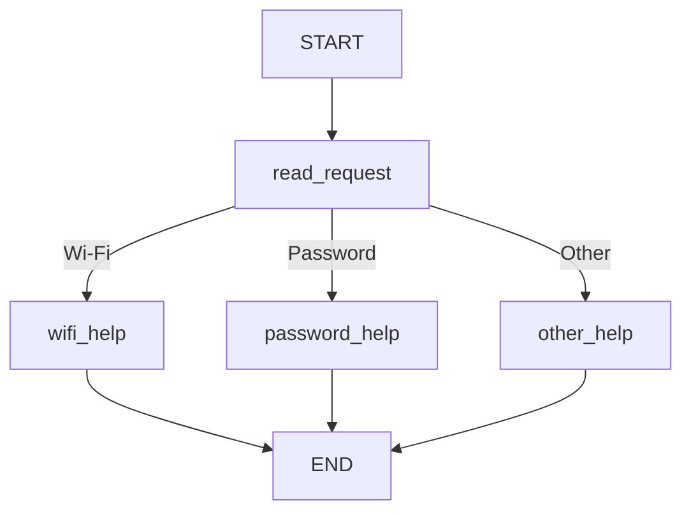

# HW5 — My LangGraph helpdesk

## Part 1 — How the graph works

### My graph and state

## Part 1 — How the graph works

### My graph and state

The state contains three fields:

| Field | Meaning |
| --- | --- |
| message | The original user message |
| category | The category selected by read_request |
| reply | The answer from a help node |

The nodes read and update these fields:

| Node | Reads | Updates |
| --- | --- | --- |
| read_request | message | category |
| wifi_help | category and the Wi-Fi guide in data/helpdesk.json | reply |
| password_help | category and the password guide in data/helpdesk.json | reply |
| other_help | category | reply |

The original message stays in the state.

#### 1. What does each node read and change?

read_request reads the message and sets the category.
The help nodes set the reply.
The Wi-Fi and password nodes use instructions from data/helpdesk.json.
other_help asks whether the problem is about Wi-Fi or a password.

#### 2. State update versus conditional edge

A node returns an update to the state, for example a category.
The conditional edge reads the category and selects the next node.
Changing the state and choosing the next node are separate actions.

#### 3. What does the next node receive?

The next node receives the current graph state.
It does not receive only the previous node's update.
For example, the original message is still available after the category is set.

#### 4. START, END and compilation

START is the entry point of the graph.
END marks the end of a graph run.
Compiling builds an executable graph from its nodes and edges.
Compilation does not run a user request.

### Predictions before running
These predictions were written before running the program.
The actual routes will be recorded after execution.

| Message | Predicted route | Actual route | What I learned |
| --- | --- | --- | --- |
| I cannot connect to Wi-Fi. | START → read_request → wifi_help → END | START → read_request → wifi_help → END | The Wi-Fi keyword selects wifi_help. |
| I forgot my PASSWORD. | START → read_request → password_help → END | START → read_request → password_help → END | Uppercase letters do not affect routing because the message is converted to lowercase. |
| My laptop screen is broken. | START → read_request → other_help → END | START → read_request → other_help → END | An unsupported topic leads to a question about Wi-Fi or passwords. |
| My Wi-Fi password does not work. | START → read_request → wifi_help → END | START → read_request → wifi_help → END | The Wi-Fi rule is checked first, so it takes priority when both topics appear. |

For the fourth message, I predict wifi_help because the Wi-Fi rule is checked first.
The password rule is checked only if the Wi-Fi rule does not match.

### My change to the graph

TODO: draw the graph with clarify_problem, show the new trace, and explain the difference. What does LangGraph control, and what do my functions decide?

## Part 2 — Model and tools

TODO: draw the model/tool loop. Answer the four questions in the brief. Record the model and provider, direct calls to each tool, and one actual run that uses multiple tools. Explain the loop limit.

## Part 3 — Memory

TODO: explain conversation state, thread_id, user identifier, user preference storage, and retrieval from helpdesk.json.

| Situation | Command used | Log file | What happened |
| --- | --- | --- | --- |
| Refer to an earlier message | | | |
| Close, restart and resume | | | |
| Same user, new conversation | | | |
| Different user | | | |

## Part 4 — Running and checking my work

TODO: point to the README setup steps, package versions, memory-reset instructions, tests and GitHub Actions workflow. Explain which mistake each test catches and which runs use a fake model.

## Choices and limitations

TODO: explain the storage and libraries I chose, why they fit this task, and what still does not work reliably.

## Supplied scenarios — my actual results

| Scenario | Command or manual steps | Log file | What happened / what I changed |
| --- | --- | --- | --- |
| S01 — Simple Wi-Fi route | | | |
| S02 — Case-insensitive password route | | | |
| S03 — Unsupported request | | | |
| S04 — Two topics before the graph change | | | |
| S05 — Two topics after adding clarification | | | |
| S06 — Instructions then local ticket | | | |
| S07 — The same request during a Wi-Fi outage | | | |
| S08 — Status source unavailable | | | |
| S09 — Missing ticket details | | | |
| S10 — Use the current conversation | | | |
| S11 — Persist and recall after restart | | | |
| S12 — Preference across threads without replay | | | |
| S13 — Do not share memory between users | | | |
| S14 — Password recovery outage | | | |
